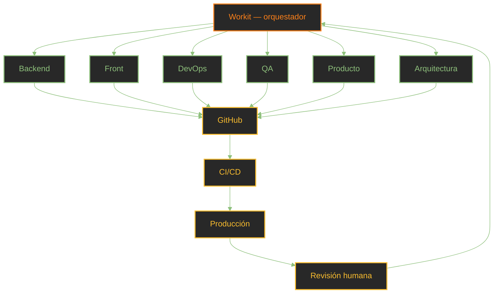
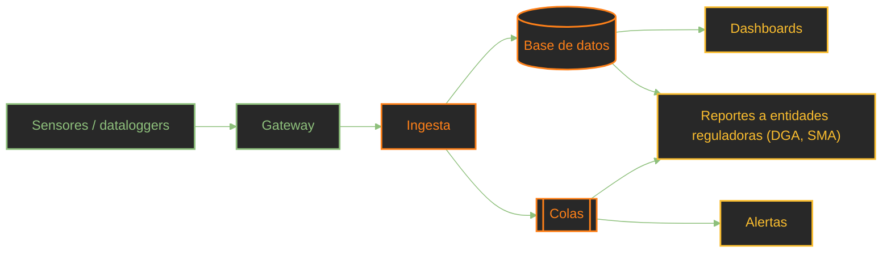
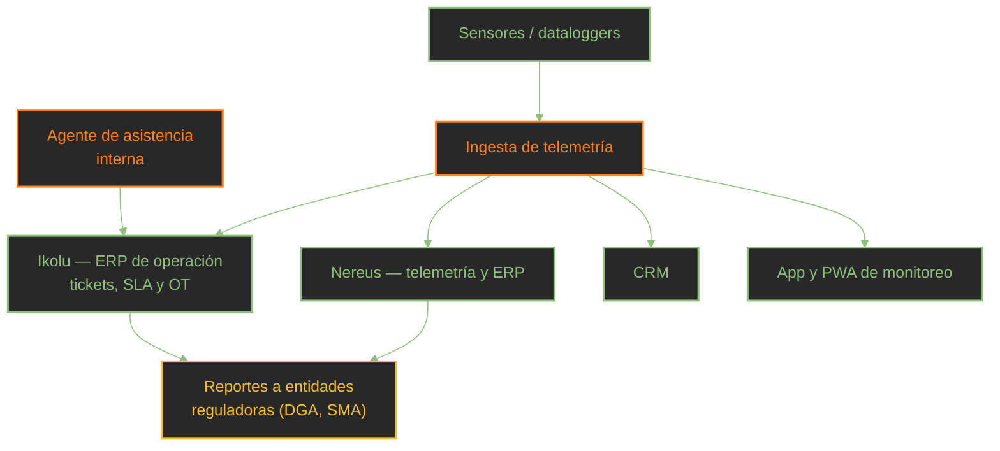

  

 

Soy Felipe Barraza, Developer + IA & IoT.

Mi misión como profesional es transformar problemas reales en productos de software robustos, seguros y listos para escalar. Desde 2012 diseño arquitecturas, desarrollo y mantengo infraestructuras. Trabajo con agentes de IA como parte de mi equipo, en cada etapa del desarrollo, para construir productos más sólidos y de mejor calidad.

Lidero el área de software en una empresa de ingeniería y telemetría (IoT y automatización de gestión regulatoria), soy CTO y socio en Quality Net, y desarrollo mis propios productos en Y ARQ.

  
  &nbsp;
  
  &nbsp;
  

**Ahora** — Desde enero de 2021 soy Líder de Área de Software en [SmartHydro](https://smarthydro.cl), en Chillán. Trabajo de forma directa con el CTO. También soy CTO y socio en Quality Net, y desarrollo mis propios productos en Y ARQ.

**Qué hago** — En esa empresa de ingeniería y telemetría trabajo con IoT, IA aplicada y la automatización de la gestión regulatoria ante distintas entidades, entre ellas la DGA y la SMA. El objetivo es que la información de terreno sea confiable y llegue a quienes operan y a quienes deben cumplir y fiscalizar la normativa.

**Mi rol**

- **Estrategia y arquitectura** — Lidero la arquitectura de datos y de las plataformas de Operaciones y Ventas, en alineación directa con el CTO y las prioridades del negocio.
- **I+D en IA e IoT** — Desarrollo investigación aplicada en IA e IoT y prototipo agentes multimodales de IA para operaciones institucionales.
- **Desarrollo y liderazgo técnico** — Lidero el equipo de software en la revisión y la entrega a producción, con mejora continua.
- **Infraestructura y operación** — Administro la infraestructura en la nube y la operación cotidiana, para la continuidad y la confiabilidad de la telemetría.
- **Gestión y automatización interna** — Administro el espacio de trabajo, las automatizaciones internas y los servicios que sostienen la operación cotidiana.

**Stack**

  

MQTT · WebSockets · TimescaleDB · Apps Script · agentes de IA

**Sistema de agentes**

Orquesto el trabajo de software con un sistema de agentes. Cada entrega a producción se cierra con una revisión humana.

**Arquitectura IoT**

Así fluye la telemetría: desde el sensor hasta los reportes que deben llegar a las entidades reguladoras, entre ellas la DGA y la SMA.

**Plataformas de operación y telemetría**

Estas son las piezas del producto con las que trabajamos a diario en SmartHydro, y cómo se conectan hasta el cumplimiento ante la DGA y la SMA.

**Proyecto Y ARQ**

Y ARQ nació para no construir cada producto desde cero. Es un backend multi-tenant con un contrato compartido: una sola instalación atiende varias sucursales, cada una con sus datos aislados, y los módulos se activan según el plan. El contrato es el mismo para todas las aplicaciones, de modo que cada producto arma su interfaz sin reimplementar el núcleo. Así se pueden adoptar clientes de distintos sectores a partir de un mismo tronco.

- [Sitio de Y ARQ](https://github.com/felipebarraza6/yggdra-web) — portafolio técnico del backend y de las apps que lo usan · [sitio](https://felipebarraza6.github.io/yggdra-web/)
- [Muninn](https://github.com/felipebarraza6/muninn) — cliente para diseñar y operar agentes de IA · [demo](https://felipebarraza6.github.io/muninn/)
- [Frig](https://github.com/felipebarraza6/frig) — solución de gestión gastronómica integral: punto de venta, mesas, comandas de cocina, caja, inventario, recetas, finanzas y reportes · [sitio](https://frig.yggdra.cl)
- [Nxord](https://github.com/felipebarraza6/nxord) — plataforma de gestión hídrica y telemetría en tiempo real · [demo](https://felipebarraza6.github.io/nxord/)
- [HEIR](https://github.com/felipebarraza6/heir) — agenda, pagos y agente conversacional para profesionales de la salud · [demo](https://felipebarraza6.github.io/heir/)
- [Forja](https://github.com/felipebarraza6/forja) — plataforma para personal trainers: venta de servicios y gestión de alumnos · [demo](https://felipebarraza6.github.io/forja/)
- [Gungir](https://github.com/felipebarraza6/gungir) — comercio general y cotizador · [demo](https://felipebarraza6.github.io/gungir/)
- [Y Print](https://github.com/felipebarraza6/y-print) — agente de impresión nativo: se autentica contra el backend e imprime según los permisos de la sucursal

**Proyectos destacados**

Además de Y ARQ, he construido herramientas y sitios pensados para un uso concreto: el agua potable rural, un desafío de 90 días, o la presencia digital de una organización.

- [Cauce](https://github.com/felipebarraza6/nxrd_apr) — cliente web del ciclo de agua potable rural: socio, medidor, lectura, tarifa vigente y cobro del período, para la administración del comité, las lecturas en terreno y la caja · [sitio](https://cauce.smartapr.cl)
- [Proyecto 90](https://github.com/felipebarraza6/proyecto-90) — landing, inscripción, seguimiento del participante y panel del equipo para un desafío de 90 días
- [Valentino Automotora](https://github.com/felipebarraza6/web_valentino_automotora) — prototipo web estático de la automotora: ficha de vehículos y un asistente de consulta simulado en el navegador · [demo](https://felipebarraza6.github.io/web_valentino_automotora/)
- [Andean Labs](https://github.com/felipebarraza6/andean-labs-web) — sitio institucional estático, con noticias, convenios, galería y versiones en español, inglés y chino · [demo](https://felipebarraza6.github.io/andean-labs-web/)

  

[felipe.barraza.vega@gmail.com](mailto:felipe.barraza.vega@gmail.com)
