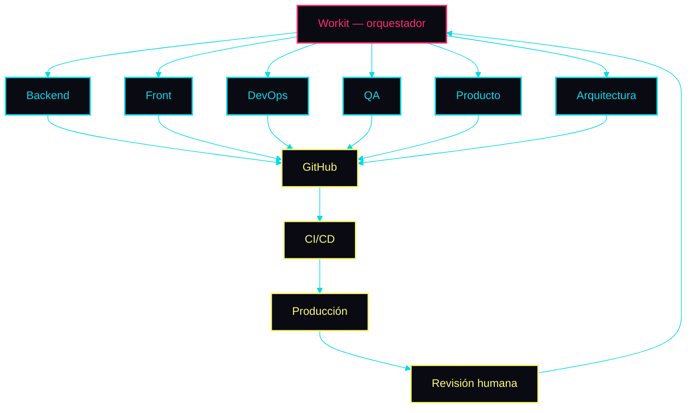
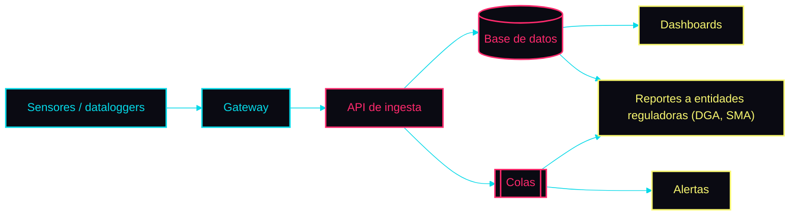
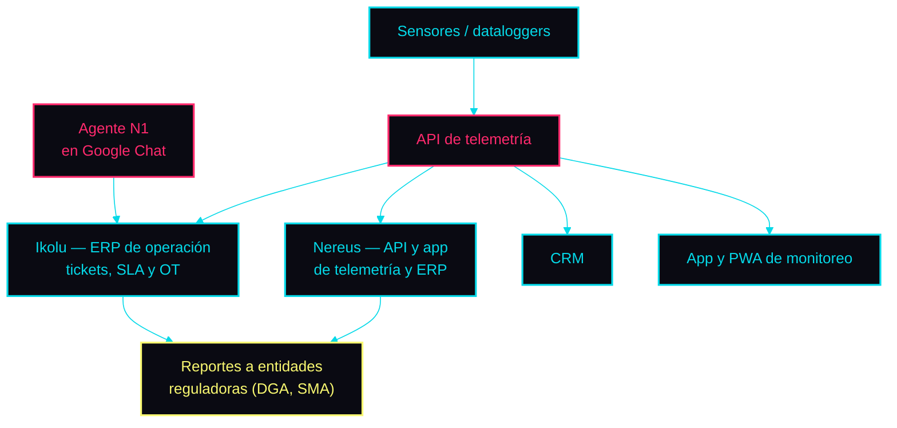

  

 

Soy Felipe Barraza. Lidero el área de software de [SmartHydro](https://smarthydro.cl). Me mueve que la tecnología sirva al cumplimiento ambiental y a las personas que operan, regulan o dependen de esa información. Trabajo para dejar sistemas que se puedan sostener en el tiempo: claros, operables y al servicio de un propósito.

  
  &nbsp;
  

**Ahora** — Desde abril de 2023 soy Líder de Área de Software en [SmartHydro](https://smarthydro.cl), en Chillán. Trabajo de forma directa con el CTO.

**Qué hago** — [SmartHydro](https://smarthydro.cl) es una startup chilena de telemetría de agua, líder por la vanguardia técnica de su producto: telemetría IoT, IA aplicada y la gestión del cumplimiento normativo ante distintas entidades, entre ellas la DGA y la SMA (Superintendencia del Medio Ambiente). Ese trabajo busca que la información del agua sea confiable y llegue a quienes operan en terreno y a quienes deben cumplir y fiscalizar la normativa. El código de la empresa vive en la organización [Smart-Hydro](https://github.com/Smart-Hydro).

**Mi rol**

- **Estrategia y arquitectura** — Lidero la arquitectura de datos y de las plataformas de Operaciones y Ventas, en alineación directa con el CTO y las prioridades del negocio.
- **I+D en IA e IoT** — Desarrollo investigación aplicada en IA e IoT y prototipo agentes multimodales de IA para operaciones institucionales.
- **Desarrollo y liderazgo técnico** — Lidero el equipo de software en estándares, revisión y entrega a producción de APIs, frontends y automatizaciones, con mejora continua.
- **Infraestructura y operación** — Administro la infraestructura en DigitalOcean y Cloudflare y la organización en Google Cloud, para la continuidad operacional y la confiabilidad de la telemetría.
- **Gestión y automatización interna** — Administro Google Workspace, las automatizaciones internas (Apps Script y el agente de Google Chat N1) y los proveedores y dominios que sostienen la operación cotidiana.

**Sistema de agentes**

Orquesto el trabajo de software con un sistema de agentes. Cada entrega a producción se cierra con una revisión humana.

**Arquitectura IoT**

Así fluye la telemetría: desde el sensor hasta los reportes que deben llegar a las entidades reguladoras, entre ellas la DGA y la SMA.

**Productos de SmartHydro**

Estas son las piezas del producto con las que trabajamos a diario, y cómo se conectan hasta el cumplimiento ante la DGA y la SMA.

**Proyecto Y ARQ**

Y ARQ nació para no construir cada producto desde cero. Es un backend multi-tenant con una API compartida: una sola instalación atiende varias sucursales, cada una con sus datos aislados, y los módulos se activan según el plan. El contrato de la API es el mismo para todas las aplicaciones, de modo que cada producto arma su interfaz sin reimplementar el núcleo. Así se pueden adoptar clientes de distintos sectores a partir de un mismo tronco.

- [Sitio de Y ARQ](https://github.com/felipebarraza6/yggdra-web) — portafolio técnico del backend y de las apps que lo usan · [sitio](https://felipebarraza6.github.io/yggdra-web/)
- [Muninn](https://github.com/felipebarraza6/muninn) — cliente para diseñar y operar agentes de IA · [demo](https://felipebarraza6.github.io/muninn/)
- [Frig](https://github.com/felipebarraza6/frig) — solución de gestión gastronómica integral: punto de venta, mesas, comandas de cocina, caja, inventario, recetas, finanzas y reportes · [sitio](https://frig.yggdra.cl)
- [Nxord](https://github.com/felipebarraza6/nxord) — plataforma de gestión hídrica y telemetría en tiempo real · [demo](https://felipebarraza6.github.io/nxord/)
- [HEIR](https://github.com/felipebarraza6/heir) — agenda, pagos y agente conversacional para profesionales de la salud · [demo](https://felipebarraza6.github.io/heir/)
- [Forja](https://github.com/felipebarraza6/forja) — plataforma para personal trainers: venta de servicios y gestión de alumnos · [demo](https://felipebarraza6.github.io/forja/)
- [Gungir](https://github.com/felipebarraza6/gungir) — comercio general y cotizador · [demo](https://felipebarraza6.github.io/gungir/)
- [Y Print](https://github.com/felipebarraza6/y-print) — agente de impresión nativo: se autentica contra la API e imprime según los permisos de la sucursal

**Proyectos destacados**

Además de Y ARQ, he construido herramientas y sitios pensados para un uso concreto: el agua potable rural, un desafío de 90 días, o la presencia digital de una organización.

- [Cauce](https://github.com/felipebarraza6/nxrd_apr) — cliente web del ciclo de agua potable rural: socio, medidor, lectura, tarifa vigente y cobro del período, para la administración del comité, las lecturas en terreno y la caja · [sitio](https://cauce.smartapr.cl)
- [Proyecto 90](https://github.com/felipebarraza6/proyecto-90) — landing, inscripción, seguimiento del participante y panel del equipo para un desafío de 90 días
- [Valentino Automotora](https://github.com/felipebarraza6/web_valentino_automotora) — prototipo web estático de la automotora: ficha de vehículos y un asistente de consulta simulado en el navegador · [demo](https://felipebarraza6.github.io/web_valentino_automotora/)
- [Andean Labs](https://github.com/felipebarraza6/andean-labs-web) — sitio institucional estático, con noticias, convenios, galería y versiones en español, inglés y chino · [demo](https://felipebarraza6.github.io/andean-labs-web/)

  

[felipe.barraza.vega@gmail.com](mailto:felipe.barraza.vega@gmail.com)
